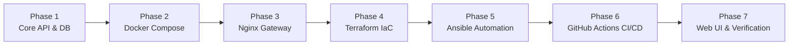

# Multi-Container Application Architecture & Roadmap

> **Based on roadmap.sh DevOps Project:** [Multi-Container Application](https://roadmap.sh/projects/multi-container-application)  
> **Status:** Architecture Approved | Ready for Phase-by-Phase Implementation  
> **Rule Followed:** *Documentation and Architecture Defined First; No Code Started.*

---

## 📑 Core Documentation Index

This repository contains the complete 5-part engineering blueprint designed to build, deploy, and maintain a production-grade multi-container cloud application:

| Document | File Link | Summary & Purpose |
| :--- | :--- | :--- |
| **1. Product Requirements Document** | [PRD.md](file:///c:/AAE/PRD.md) | Defines the problem statement, personas, MVP scope, core features, must-haves vs. nice-to-haves, user flows, and success metrics. |
| **2. Technical Architecture** | [TECHNICAL_ARCHITECTURE.md](file:///c:/AAE/TECHNICAL_ARCHITECTURE.md) | Details the tech stack with versions, system architecture diagram, directory tree, MongoDB schema, container networking, and environment variables. |
| **3. Security & Access Document** | [SECURITY_AND_ACCESS.md](file:///c:/AAE/SECURITY_AND_ACCESS.md) | Outlines authentication, role-based access, container isolation, firewall policies, uniform error handling schemas, and edge case resilience. |
| **4. Frontend & API Specification** | [FRONTEND_SPECIFICATION.md](file:///c:/AAE/FRONTEND_SPECIFICATION.md) | Full design system (color palette, typography, component styles, 8pt grid) and complete API endpoint integration contract with schemas. |
| **5. Feature Ticket List** | [FEATURE_TICKET_LIST.md](file:///c:/AAE/FEATURE_TICKET_LIST.md) | 20 prompt-ready tickets divided into 7 sequential implementation phases with acceptance criteria and dependencies. |

---

## 🏗️ Phase-Wise Architectural Roadmap

The project is structured into sequential phases to guarantee zero configuration drift and seamless deployment:

### 🔹 Phase 1: Core API & Database Foundation
- Standalone Node.js + Express REST service
- MongoDB connection with exponential backoff retry loop
- CRUD controllers (`/todos`) with strict Mongoose validation
- Centralized error handling and `/health` diagnostic endpoint

### 🔹 Phase 2: Local Containerization & Volume Persistence
- Multi-stage production `Dockerfile` (`node:20-alpine`)
- `docker-compose.yml` orchestrating API and MongoDB on isolated bridge network
- Named Docker volume (`mongodb_data`) guaranteeing zero data loss across restarts
- Development hot-reloading with nodemon

### 🔹 Phase 3: Gateway & Reverse Proxy Layer (Nginx)
- Nginx Alpine container acting as single public entrypoint (Port 80/443)
- Internal DNS routing to `http://api:5000`
- Complete isolation of MongoDB port `27017` from public network
- Production hardening headers and rate limiting

### 🔹 Phase 4: Infrastructure as Code (Terraform)
- Automated cloud VM provisioning (AWS EC2 / DigitalOcean Droplet)
- Automated VPC, security groups, and cloud firewall configuration
- SSH key injection for passwordless administrative access

### 🔹 Phase 5: Server Configuration Management (Ansible)
- Automated playbook installing official Docker Engine & Docker Compose
- Dedicated `deployer` user setup and system hardening (UFW firewall)
- Automated pull of images and container stack launch

### 🔹 Phase 6: Continuous Integration & Deployment (GitHub Actions)
- Automated linting and endpoint integration tests on push/PR
- Multi-platform Docker image build and publication to Docker Hub
- Automated SSH deployment triggering zero-downtime container rollout

### 🔹 Phase 7: Web Dashboard & Disaster Recovery Drill
- Modern, dark-themed responsive client UI for managing tasks visually
- End-to-end verification script testing persistence after container teardown

---

## 🔒 Security Summary
- **Network Boundaries:** Only port 80/443 (Nginx) and port 22 (SSH) are exposed to the public internet.
- **Internal Database:** MongoDB is bound strictly to the internal Docker bridge network (`todo_network`).
- **Least Privilege:** Web containers run under unprivileged non-root user accounts (`USER node`).
- **Resilience:** Automatic container restart policy (`unless-stopped`) and database connection retry loops.

---

## 🚀 How to Begin Building
Once you are ready to start coding, proceed to **Phase 1** using the prompt-ready tickets in [FEATURE_TICKET_LIST.md](file:///c:/AAE/FEATURE_TICKET_LIST.md#phase-1-core-api--database-foundation).
