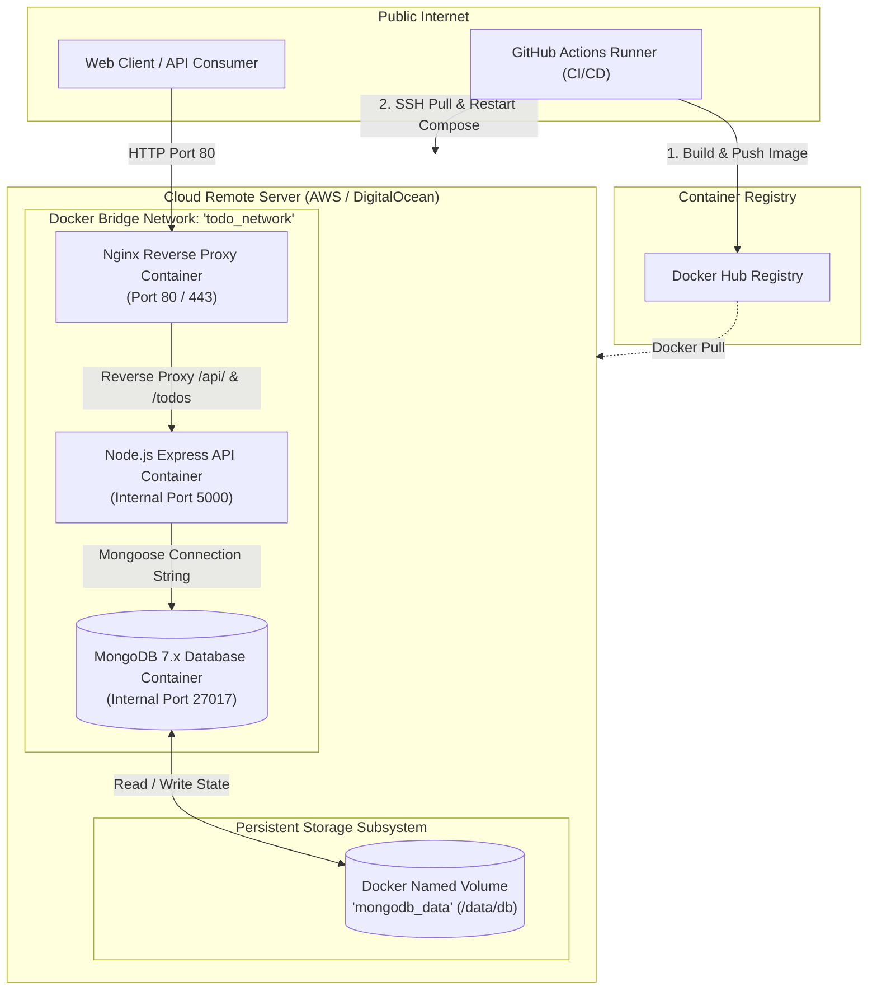

# Technical Architecture Document

**Project Name:** Multi-Container Cloud Application (Todo Platform)  
**Document Version:** 1.0.0  
**Status:** Approved Architectural Blueprint  
**Target Environment:** Local (Docker Desktop) & Production (AWS EC2 / DigitalOcean)  

---

## 1. System Architecture Overview

The system follows a containerized 3-tier micro-architecture orchestrated via Docker Compose, automated through Infrastructure as Code (Terraform), system configuration automation (Ansible), and continuous deployment (GitHub Actions).



---

## 2. Phase-Wise Architectural Roadmap

To ensure modularity and zero technical ambiguity, the architecture is designed across 6 distinct phases:

```
┌─────────────────────────────────────────────────────────────────────────────┐
│ PHASE 1: Core API & Data Layer (Express.js + Mongoose + Local MongoDB)     │
└─────────────────────────────────────────────────────────────────────────────┘
                                      │
                                      ▼
┌─────────────────────────────────────────────────────────────────────────────┐
│ PHASE 2: Local Containerization (Docker Multi-Stage Build + Compose Orchestration)│
└─────────────────────────────────────────────────────────────────────────────┘
                                      │
                                      ▼
┌─────────────────────────────────────────────────────────────────────────────┐
│ PHASE 3: Gateway Layer (Nginx Reverse Proxy + Custom Docker Networking)    │
└─────────────────────────────────────────────────────────────────────────────┘
                                      │
                                      ▼
┌─────────────────────────────────────────────────────────────────────────────┐
│ PHASE 4: Infrastructure as Code (Terraform VPS Provisioning + Cloud Security)│
└─────────────────────────────────────────────────────────────────────────────┘
                                      │
                                      ▼
┌─────────────────────────────────────────────────────────────────────────────┐
│ PHASE 5: Configuration & Deployment Automation (Ansible + GitHub Actions CI/CD)│
└─────────────────────────────────────────────────────────────────────────────┘
                                      │
                                      ▼
┌─────────────────────────────────────────────────────────────────────────────┐
│ PHASE 6: Production Hardening, Client Dashboard & Observability             │
└─────────────────────────────────────────────────────────────────────────────┘
```

### Phase 1: Core API & Data Layer
- Develop standalone Node.js Express server.
- Establish Mongoose connection to MongoDB with auto-reconnect logic.
- Implement RESTful controllers for `/todos` and `/health`.
- Validate input using schema validation (Joi or Zod).

### Phase 2: Local Containerization & Storage Isolation
- Craft production-grade multi-stage `Dockerfile` using Node 20 Alpine.
- Define `docker-compose.yml` defining `api` and `mongodb` services.
- Define named Docker volume `mongodb_data` to ensure persistence across container removals.
- Establish local bridge network `todo_network` for internal DNS resolution (`mongodb:27017`).

### Phase 3: Gateway & Reverse Proxy Layer
- Configure Nginx container as the single entrypoint (Port 80/443).
- Implement rate limiting, gzip compression, and security headers.
- Route `/api` and `/todos` requests upstream to `http://api:5000`.
- Isolate the MongoDB container so its port (27017) is completely unmapped to the host network.

### Phase 4: Infrastructure as Code (IaC)
- Create modular Terraform configuration targeting cloud provider (DigitalOcean Droplet or AWS EC2).
- Provision VPC, Subnet, Internet Gateway, and Firewall/Security Groups (allowing Port 22 for SSH, Port 80 for HTTP, Port 443 for HTTPS).
- Automate SSH key injection for passwordless administrative access.

### Phase 5: Configuration Management & CI/CD Pipeline
- Write Ansible playbooks to bootstrap the target server: install Docker Engine, Docker Compose plugin, create non-root deployer user, and configure firewall rules.
- Set up GitHub Actions workflow:
  1. Trigger on push to `main`.
  2. Run unit & integration tests.
  3. Build and push production image to Docker Hub (`<username>/todo-api:latest`).
  4. SSH to target server, sync `docker-compose.prod.yml`, pull latest images, and restart services with zero downtime.

### Phase 6: Client Interface & Health Observability
- Deploy lightweight, responsive web dashboard for visual verification.
- Structured JSON logging (Pino/Winston) and health monitoring metrics.

---

## 3. Technology Stack & Decision Rationale

| Category | Technology | Version | Rationale & Selection Criteria |
| :--- | :--- | :--- | :--- |
| **Backend Runtime** | Node.js | `v20.x LTS` (Iron) | Enterprise standard, high I/O throughput, small Alpine container footprint (<150MB). |
| **Web Framework** | Express.js | `v4.19+` | Minimalist, unopinionated, universal community support, predictable middleware chaining. |
| **Database** | MongoDB Community | `v7.0+` | Flexible JSON document model natively suited for hierarchical todo items; officially maintained Docker image. |
| **Database ODM** | Mongoose | `v8.x` | Provides robust schema validation, casting, middleware hooks, and connection pooling out of the box. |
| **Container Engine** | Docker Engine & CLI | `v26.x+` | Standard container runtime ensuring complete environment parity between dev and prod. |
| **Orchestration** | Docker Compose | `v2.27+` | Declarative multi-container definitions with built-in networking, service dependencies (`depends_on`), and volume management. |
| **Reverse Proxy** | Nginx | `v1.25 Alpine` | High concurrency HTTP reverse proxy, static file serving, and upstream load routing. |
| **Infrastructure as Code** | Terraform | `v1.8+` | Declarative cloud resource provisioning with state tracking, multi-provider portability (AWS/DigitalOcean). |
| **Configuration Mgmt** | Ansible | `v2.16+ Core` | Agentless configuration management over SSH; perfectly automates Docker daemon installation and system updates. |
| **CI/CD Automation** | GitHub Actions | Standard V4 Actions | Deep native Git integration, secret masking, container caching, and automated remote deploy execution. |
| **Development Tooling** | Nodemon & Docker Compose Watch | Latest | Hot-reloading inside containers during active development cycles without full image rebuilds. |

---

## 4. Complete File & Folder Structure

```
c:\AAE\
├── .github/
│   └── workflows/
│       ├── test.yml                   # CI: Runs linter & integration test suite
│       └── deploy.yml                 # CD: Builds image, pushes to Docker Hub, deploys via SSH
├── ansible/
│   ├── inventory.ini                  # Target server IP and connection variables
│   ├── playbook.yml                   # Main automation playbook (Docker install & container launch)
│   ├── roles/
│   │   ├── common/                    # System update, UFW firewall, baseline packages
│   │   ├── docker/                    # Docker Engine & Docker Compose installation
│   │   └── app/                       # Compose deployment & configuration synchronization
│   └── ansible.cfg                    # Ansible default parameters & SSH options
├── terraform/
│   ├── main.tf                        # Resource definitions (VM instance, security rules)
│   ├── variables.tf                   # Input parameters (region, instance size, SSH keys)
│   ├── outputs.tf                     # Server public IP and connection strings
│   ├── terraform.tfvars.example       # Example cloud credentials and variables
│   └── provider.tf                    # Cloud provider configuration (AWS / DigitalOcean)
├── api/
│   ├── src/
│   │   ├── config/
│   │   │   └── db.js                  # Mongoose connection & retry loop logic
│   │   ├── controllers/
│   │   │   ├── todo.controller.js     # CRUD business logic
│   │   │   └── health.controller.js   # Health & DB ping handler
│   │   ├── models/
│   │   │   └── todo.model.js          # Mongoose schema definition
│   │   ├── routes/
│   │   │   ├── todo.routes.js         # /todos router
│   │   │   └── health.routes.js       # /health router
│   │   ├── middleware/
│   │   │   ├── errorHandler.js        # Global error middleware
│   │   │   └── validator.js           # Request body validation middleware
│   │   └── app.js                     # Express app setup & middleware chain
│   ├── server.js                      # Server entry point & graceful shutdown hooks
│   ├── package.json                   # Dependencies and scripts
│   ├── Dockerfile                     # Multi-stage production container build
│   └── Dockerfile.dev                 # Development container with nodemon hot-reload
├── proxy/
│   ├── nginx.conf                     # Production reverse proxy routing & security headers
│   └── Dockerfile                     # Nginx Alpine container definition
├── client/
│   └── public/
│       ├── index.html                 # Lightweight responsive Todo Web Dashboard
│       ├── app.js                     # Client API fetch calls & DOM reactivity
│       └── style.css                  # Modern Tailwind/Vanilla CSS styles
├── docker-compose.yml                 # Local development orchestration
├── docker-compose.prod.yml            # Production deployment orchestration
├── .env.example                       # Documented environment variables template
├── .gitignore                         # Git exclusion rules
├── PRD.md                             # Product Requirements Document
├── TECHNICAL_ARCHITECTURE.md          # Technical Architecture Specification (This file)
├── SECURITY_AND_ACCESS.md             # Security, Access & Error Handling Specification
├── FRONTEND_SPECIFICATION.md          # Frontend & API Integration Specification
└── FEATURE_TICKET_LIST.md             # Step-by-step task breakdown checklist
```

---

## 5. Database Schema & Data Modeling

The application utilizes MongoDB to store Todo documents. Below is the relational and schema breakdown:

### Collection: `todos`

| Field Name | Type | Required | Default | Indexed | Description |
| :--- | :--- | :--- | :--- | :--- | :--- |
| `_id` | `ObjectId` | Yes | Auto (UUIDv4) | Yes (Primary) | Unique identifier generated by MongoDB. |
| `title` | `String` | Yes | None | Yes (Text) | The main task summary (min: 1 char, max: 200 chars). Trimmed. |
| `description` | `String` | No | `""` | No | Optional expanded notes or instructions (max: 2000 chars). |
| `isCompleted` | `Boolean` | Yes | `false` | Yes | Status flag indicating whether the task is completed. |
| `createdAt` | `Date` | Yes | Auto | Yes (Desc) | Timestamp when record was inserted. |
| `updatedAt` | `Date` | Yes | Auto | No | Timestamp when record was last modified. |

### Plain-English Schema Explanation
Think of the `todos` collection as a clean, structured spreadsheet:
- **`_id`**: A permanent, unique tracking number assigned to every item.
- **`title`**: What needs to be done (e.g., "Set up remote server"). Must not be blank.
- **`description`**: Additional details about the task (e.g., "Use Terraform on DigitalOcean").
- **`isCompleted`**: A checkbox that is either `true` (checked) or `false` (unchecked).
- **`createdAt` / `updatedAt`**: Automatically managed timestamps recording when the item was created and last updated.

---

## 6. Container Networking & Volume Architecture

### Docker Compose Service Architecture

```
                  ┌────────────────────────────────────────┐
                  │          Host System / OS              │
                  │                                        │
                  │    Port 80 (HTTP)    Port 443 (HTTPS)  │
                  └──────────┬───────────────────┬─────────┘
                             │                   │
                             ▼                   ▼
                  ┌────────────────────────────────────────┐
                  │       Container: 'reverse-proxy'       │
                  │             (Nginx Alpine)             │
                  └──────────────────┬─────────────────────┘
                                     │
                     Internal Network: 'todo_network'
                                     │
                 ┌───────────────────┴───────────────────┐
                 │                                       │
                 ▼                                       ▼
  ┌──────────────────────────────┐       ┌──────────────────────────────┐
  │      Container: 'api'        │       │    Container: 'mongodb'      │
  │     (Node.js / Express)      │       │     (MongoDB 7.0 Community)  │
  │  Internal IP / Port 5000     │◄─────►│    Internal Port 27017       │
  │  (No host port binding)      │       │  (No host port binding)      │
  └──────────────────────────────┘       └──────────────┬───────────────┘
                                                        │
                                                        ▼
                                         ┌──────────────────────────────┐
                                         │  Docker Named Volume:        │
                                         │  'mongodb_data' -> /data/db  │
                                         └──────────────────────────────┘
```

### Key Networking Guarantees:
1. **Network Segmentation:** All containers participate in an isolated user-defined bridge network named `todo_network`.
2. **Perimeter Defense:** The MongoDB container does **not** map its port 27017 to the host network in production. It is reachable strictly by other containers within `todo_network` using the hostname `mongodb`.
3. **Gateway Protection:** The API container is only accessible via the Nginx reverse proxy. In local development, port 5000 can be optionally mapped to localhost for direct debugging.

---

## 7. Environment & Configuration Specification

### Environment Variables Matrix

| Variable | Scope | Default Value | Description |
| :--- | :--- | :--- | :--- |
| `NODE_ENV` | API | `development` / `production` | Dictates error verbosity, caching, and optimizations. |
| `PORT` | API | `5000` | Internal port on which Express listens. |
| `MONGO_URI` | API | `mongodb://mongodb:27017/todos_db` | Connection string pointing to internal container DNS. |
| `MONGO_INITDB_DATABASE` | DB | `todos_db` | Initial database name created on MongoDB startup. |
| `NGINX_PORT` | Proxy | `80` | Publicly exposed port for the HTTP reverse proxy. |
| `CLIENT_ORIGIN` | API | `*` (or specific domain in prod) | Allowed CORS origin for cross-site requests. |
| `DOCKER_HUB_USERNAME` | CI/CD | (Secret) | Docker Hub registry user for publishing images. |
| `DOCKER_HUB_TOKEN` | CI/CD | (Secret) | Docker Hub personal access token for automated pushes. |
| `SERVER_HOST` | CI/CD | (Secret) | Remote server IP address for automated deployment. |
| `SSH_PRIVATE_KEY` | CI/CD | (Secret) | SSH private key allowing GitHub Actions to deploy to server. |

### Configuration Rules & Guidelines:
1. **Never Commit Secrets:** The `.env` file is excluded in `.gitignore`. Only `.env.example` containing dummy defaults is tracked in git.
2. **Container DNS Resolution:** Inside Docker, service names declared in `docker-compose.yml` (`api`, `mongodb`, `proxy`) automatically resolve as hostnames via Docker's embedded DNS server (`127.0.0.11`).
3. **Graceful Connection Retries:** The API must not crash if MongoDB takes 5 seconds longer to initialize; a retry loop with exponential backoff connects automatically.
